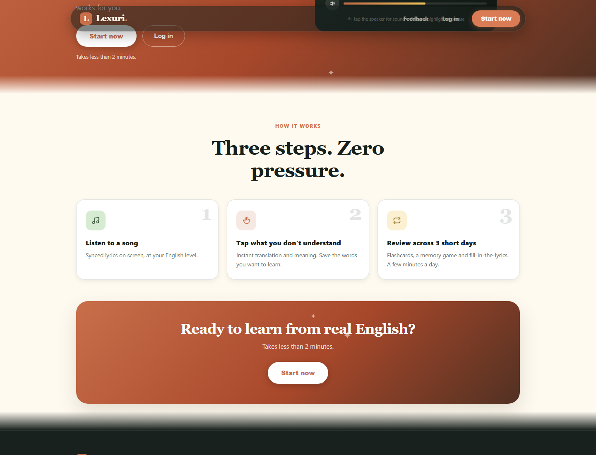

# Lexuri

**Learn English through the songs you love.** Lexuri is an open-source research app that turns music into a practical learning loop: listen with synced lyrics, explore unfamiliar expressions, and review what you learned over three short sessions.

[](LICENSE)
[Try the live app](https://lexuri-validacao.vercel.app) · [Explore the code](https://github.com/natsouzax/lexuri)

Lexuri has been tried by active learners and shaped by feedback from teachers and international participants. It is still a research prototype: the goal is to learn which parts of the experience help people return to English practice and use new language themselves.

## The experience

1. **Choose a level and a song.** Start with a curated lesson or continue through a concept album.
2. **Listen with synced lyrics.** Follow the song while the player highlights each line.
3. **Explore language in context.** Tap a word or phrase to see its translation and meaning, then save it for review.
4. **Return over three short sessions.** Practice with flashcards, a memory game, and a lyrics activity.
5. **Make the language your own.** Save personal takeaways and examples; the app uses them to build a personal glossary and verses.

The public landing page shows the core idea and its three-step learning loop:




## What is in the app

| Area | What learners can do |
| --- | --- |
| Synced music player | Follow curated lyrics alongside a YouTube video. |
| Word and phrase exploration | Translate words, inspect meanings and language chunks, and save useful items. |
| Three-day review | Practice with spaced flashcards, a memory game, and fill-in-the-lyrics activities. |
| Personal glossary | Record takeaways and examples, then turn them into generated verses. |
| Albums | Work through selected concept albums, track progress, and reflect on the album as a whole. |
| Speaking practice | Record optional practice takes and receive AI pronunciation feedback; review saved words with spaced repetition. |
| Motivation and progress | Track streaks, XP, quests, badges, and a learner leaderboard. |
| Languages | Keep the interface in English while translating learning content into one of 13 supported native languages. |
| Privacy controls | Manage profile and marketing preferences, review privacy information, and delete an account. |

## Project status and limits

Lexuri is a free research prototype. It has no paid plan, subscription, or advertising funnel. The current experience uses a curated song catalog; importing any song a learner chooses is outside the current scope. Some translation, generation, and speech features require an OpenAI API key and are subject to daily usage limits.

The codebase includes the product features listed above, but production availability depends on the live deployment and its Supabase/OpenAI configuration. OAuth is not enabled in the sign-in flow. See the [roadmap](./_plans/roadmap.md) for implementation notes and planned work.

## Tech stack

- **Application:** Next.js 16.3 App Router, React 19, TypeScript, Node.js 24
- **Styling:** Tailwind CSS 4 and a custom design system
- **Auth and data:** Supabase Auth and Postgres with Row Level Security
- **AI:** OpenAI for user-requested translation, definitions, glossary and verse generation, and optional speech transcription
- **Deployment:** Vercel
- **Lesson content:** curated, pre-generated TypeScript data; synced lyrics are prepared offline, so opening a lesson does not scrape a song at runtime

## Run locally

### Requirements

- Node.js 24.x
- npm
- Your own Supabase project and OpenAI API key for authenticated and AI-powered features

### Setup

```bash
git clone https://github.com/natsouzax/lexuri.git
cd lexuri
npm install
```

Create `.env.local` in the project root using `.env.example` as a template:

```env
NEXT_PUBLIC_SUPABASE_URL=
NEXT_PUBLIC_SUPABASE_ANON_KEY=
SUPABASE_SERVICE_ROLE_KEY=
OPENAI_API_KEY=
NEXT_PUBLIC_APP_URL=http://localhost:3000
```

Keep service-role and OpenAI keys server-side. Never add real keys to source control. Configure Supabase Auth redirect URLs for your local app before testing registration and login.

Start the development server:

```bash
npm run dev
```

Open [http://localhost:3000](http://localhost:3000). Static lesson pages can be explored without making an AI call; account-backed features need your Supabase configuration.

### Database setup

The migrations are in [`supabase/migrations/`](./supabase/migrations/). Link the Supabase CLI to **your own development project**, review the pending changes, and then apply them:

```bash
supabase db push --dry-run
npm run db:migrate
```

Do not point a local checkout at a production database while setting up the project. More deployment and rollback details are in [`_plans/deploy.md`](./_plans/deploy.md).

## Architecture

Lessons are curated and stored as static `StaticLesson` TypeScript data in [`data/featured-lessons/`](./data/featured-lessons/). Each lesson contains a transcript, timed segments, and analyzed language chunks. User accounts, preferences, learning progress, glossary entries, and optional recordings are stored in Supabase. User-owned rows are protected with Row Level Security; administrative keys stay on the server.

AI runs only when a learner requests an AI-backed action, such as a translation, definition, generated verse, or speech assessment. Offline scripts in [`scripts/`](./scripts/) support lesson curation and synchronization.

## Project docs

- [Product roadmap and current scope](./_plans/roadmap.md)
- [Documentation index](./_plans/README.md)
- [Beta test runbook](./_plans/beta-test-runbook.md)
- [Deployment and rollback](./_plans/deploy.md)
- [Music Studio notes](./_docs/music-studio.md)

## Contributing

Lexuri is open source under the MIT License. You can use, modify, and redistribute the original software, including in your own app, while preserving the copyright and license notice. Contributions are welcome through GitHub issues and pull requests.

Before proposing a change, check the roadmap and explain the learner problem it addresses. Keep credentials and learner data out of commits. For product changes, include a short description of the user flow and any setup or migration impact.

### Song lyrics and other third-party content

The MIT License applies to Lexuri's original software. It does **not** grant rights to song lyrics, music recordings, video, artist names, or other third-party material. Some curated lesson files contain lyrics whose rights belong to their respective owners. Check the rights for any content before reusing, redistributing, or deploying it; replace it with content you are authorized to use when needed.

## License

Original Lexuri software is available under the [MIT License](./LICENSE). Third-party content is excluded from that grant; see the note above.
