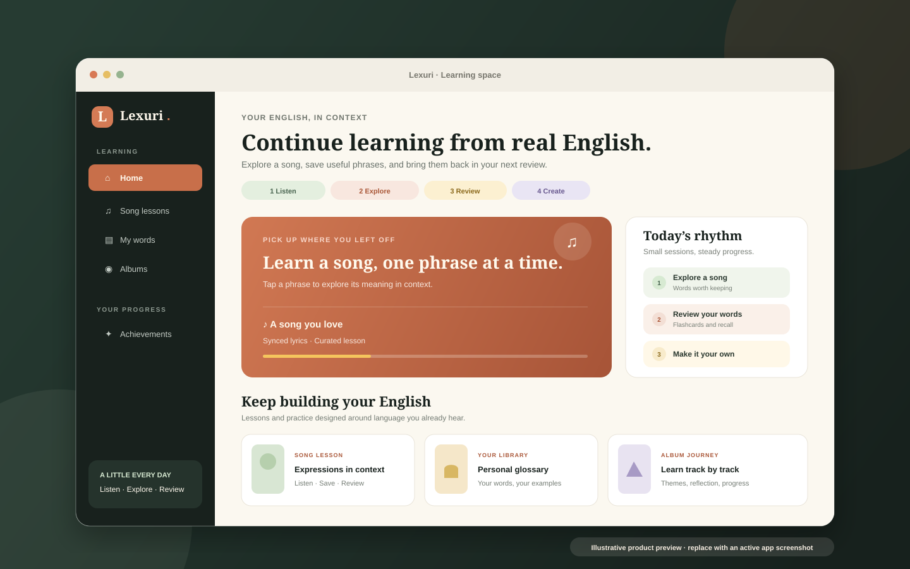

<div align="center">

<h1>Lexuri</h1>

<h3>Want to learn English beyond vocabulary lists?</h3>

<p>Learn through music you already love: explore real phrases in context, review them across three short sessions, and turn your discoveries into a personal glossary.</p>

<p>
  <a href="https://lexuri-validacao.vercel.app"><strong>Try Lexuri</strong></a>
  &nbsp;·&nbsp;
  <a href="https://github.com/natsouzax/lexuri">Explore the source</a>
  &nbsp;·&nbsp;
  <a href="LICENSE">MIT License</a>
</p>



<sub>Illustrative product preview — this image is a placeholder for a capture of the running app.</sub>

<br /><br />

<a href="https://nextjs.org"></a>
<a href="https://react.dev"></a>
<a href="https://www.typescriptlang.org"></a>
<a href="https://tailwindcss.com"></a>
<a href="https://supabase.com"></a>
<a href="https://openai.com"></a>
<a href="https://nodejs.org"></a>
<a href="https://vercel.com"></a>

</div>

## The problem Lexuri solves

Songs expose learners to natural English, but it can be hard to catch an unfamiliar phrase, understand it in context, and remember it later. Lexuri connects listening, phrase discovery, spaced review, and personal writing in one experience.

The project has been used by active learners and shaped by feedback from teachers and international participants. It is an open-source research prototype that is still evolving.

## How it works

| 1 · Listen | 2 · Explore | 3 · Review | 4 · Make it yours |
| --- | --- | --- | --- |
| Choose a curated song or video at your level. Follow along with synced text. | Tap a word or phrase to see its translation and meaning. Save useful language. | Return over three short sessions: flashcards, a memory game, and a lyrics activity. | Add takeaways and personal examples to your glossary, then turn what you learned into verses. |

## Features

- **Synced player:** follow curated lyrics alongside a YouTube video.
- **Language chunks:** explore idioms, phrasal verbs, collocations, and other useful expressions in context.
- **Spaced review:** revisit saved language with flashcards and a three-day practice cycle.
- **Personal glossary and verses:** collect takeaways and examples, then use them to generate verses.
- **Concept albums:** study selected albums track by track and reflect on the album as a whole.
- **Speaking practice:** optional recording and AI pronunciation feedback, with saved words available for review.
- **Progress and motivation:** streaks, XP, daily missions, achievements, and a leaderboard.
- **Privacy controls:** manage account settings, marketing preferences, and account deletion.

## 13 language options

The interface is in English. Learners can choose a language for translations and learning content from these 13 options:

<p>
  <code>English</code> · <code>Português (Brasil)</code> · <code>Español</code> · <code>Français</code> · <code>Deutsch</code> · <code>Italiano</code> · <code>日本語</code> · <code>한국어</code> · <code>中文 (简体)</code> · <code>العربية</code> · <code>Türkçe</code> · <code>Русский</code> · <code>हिन्दी</code>
</p>

## Stack

| Layer | Technology |
| --- | --- |
| Web app | Next.js 16 App Router, React 19, TypeScript |
| UI | Tailwind CSS 4, custom design system, Framer Motion |
| Auth and database | Supabase Auth, Postgres, Row Level Security |
| AI features | OpenAI APIs for learner-requested translations, definitions, generation, and speech transcription |
| Deployment | Vercel |

## Product preview

The large image at the top is an **illustrative placeholder**, not a screenshot of the current authenticated app. It gives the README a stable image slot. When a real app screenshot is ready, replace [`app-preview-placeholder.svg`](./_docs/screenshots/app-preview-placeholder.svg) and keep the same filename, or update the image link above.

<details>
<summary>See screenshots of the live public landing page</summary>

<p></p>

</details>

## Run locally

### Requirements

- Node.js 24.x and npm
- Your own Supabase project for authentication and saved progress
- An OpenAI API key for AI-powered features

### Setup

```bash
git clone https://github.com/natsouzax/lexuri.git
cd lexuri
npm install
```

Create `.env.local` from `.env.example` and provide your own project values:

```env
NEXT_PUBLIC_SUPABASE_URL=
NEXT_PUBLIC_SUPABASE_ANON_KEY=
SUPABASE_SERVICE_ROLE_KEY=
OPENAI_API_KEY=
NEXT_PUBLIC_APP_URL=http://localhost:3000
```

Keep service-role and OpenAI keys on the server. Never commit real credentials. Configure your Supabase Auth redirect URLs for local development.

```bash
npm run dev
```

Open [http://localhost:3000](http://localhost:3000). Static curated lessons can be explored without an AI call; account-backed features need your Supabase configuration.

### Database migrations

The migrations are in [`supabase/migrations/`](./supabase/migrations/). Link the Supabase CLI to your own development project, review the pending changes, then apply them:

```bash
supabase db push --dry-run
npm run db:migrate
```

Do not point a local checkout at a production database during setup. See the [deployment guide](./_plans/deploy.md) for release and rollback details.

## Architecture

Curated lessons are pre-generated `StaticLesson` TypeScript files in [`data/featured-lessons/`](./data/featured-lessons/). They contain transcripts, timed segments, and analyzed language chunks, so opening a lesson does not scrape lyrics or call AI. User accounts, learning progress, glossary entries, and optional recordings are stored in Supabase; user-owned rows use Row Level Security. Offline curation and synchronization tools live in [`scripts/`](./scripts/).

## Current scope

Lexuri is currently free during research validation; no paid plan is offered today. The catalog is curated; importing any song a learner chooses is not currently supported. OAuth is not enabled. Self-hosted AI features require an OpenAI key and are subject to daily usage limits. Availability on the live site depends on its deployment and service configuration.

See the [roadmap](./_plans/roadmap.md), [documentation index](./_plans/README.md), [beta runbook](./_plans/beta-test-runbook.md), and [Music Studio notes](./_docs/music-studio.md).

## Open source and contributing

The original Lexuri software is available under the **MIT License**. You can use, modify, and redistribute it, including as the basis for your own app, while keeping the copyright and license notice. Issues and pull requests are welcome. Before contributing, check the roadmap, describe the learner problem your change addresses, and keep credentials and learner data out of commits.

### Third-party content

MIT covers Lexuri's original software; it does not grant rights to song lyrics, recordings, videos, artist names, or other third-party material. Some curated lesson files contain lyrics owned by their respective rights holders. Check content rights before reuse, redistribution, or deployment, and replace material you are not authorized to use.

## License

Original Lexuri software: [MIT](./LICENSE). Third-party content is excluded from that license.

---

<div align="center">

<h2>Want to learn English with Lexuri?</h2>

<p>Use the hosted app and start with a song you love. There is no local setup, Supabase project, or personal API key to configure.</p>

<h3><a href="https://lexuri-validacao.vercel.app">Open Lexuri and start learning →</a></h3>

<sub>The hosted app is currently free during research validation. Any future pricing will be announced on the product site.</sub>

</div>
